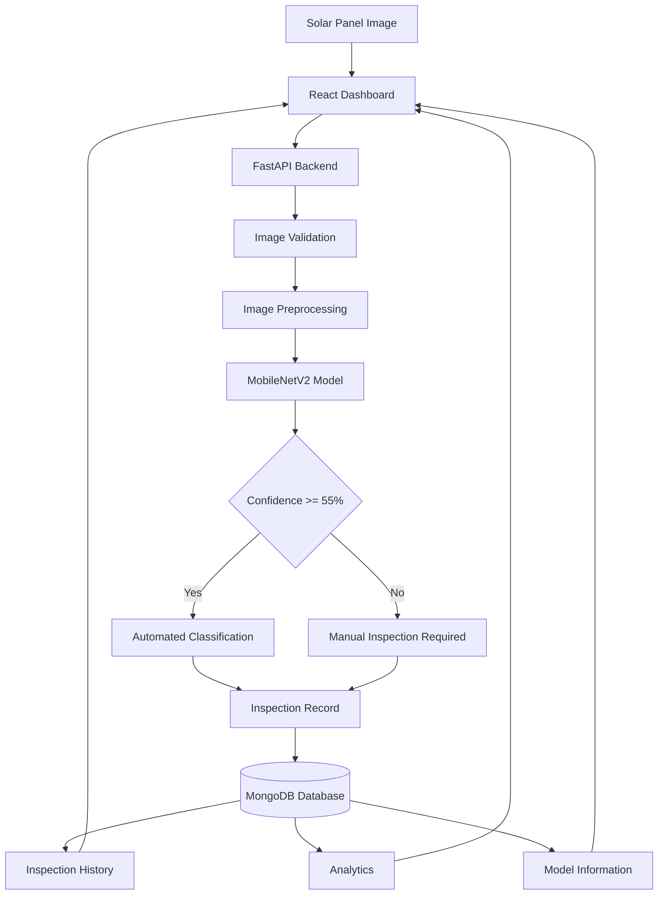

# SolarGuard AI — Industrial Solar Panel Defect Detection System

<p align="center">
  
  
  
  
  
  
  
  
</p>

<p align="center">
  An AI-powered computer vision platform for automated solar panel defect detection, inspection management, and predictive maintenance support.
</p>

---

## Overview

SolarGuard AI is an end-to-end solar panel inspection platform that uses deep learning to identify photovoltaic (PV) module defects from images.

The system combines a MobileNetV2-based image classification model, a FastAPI backend, MongoDB persistence, and a React-based industrial analytics dashboard.

It enables users to inspect solar panel images, identify potential defects, review historical inspections, analyze defect trends, and access model performance information through a centralized interface.

### Key Highlights

- **Deep Learning:** MobileNetV2 transfer learning with two-phase training and fine-tuning.
- **6-Class Classification:** Identifies healthy panels and five categories of defects or environmental conditions.
- **Test Accuracy:** 78.15% on a held-out test set of 119 images.
- **Confidence-Gated Predictions:** Low-confidence results are flagged for manual inspection.
- **Persistent Storage:** MongoDB stores inspection records and model information.
- **REST API:** FastAPI provides prediction, analytics, inspection, and model endpoints.
- **Modern Dashboard:** React and TypeScript provide a professional dark-themed interface.
- **Inspection Analytics:** Visualizes defect distributions, inspection history, and model performance.

---

## Table of Contents

- [Problem Statement](#problem-statement)
- [System Architecture](#system-architecture)
- [Features](#features)
- [Dataset](#dataset)
- [Machine Learning Model](#machine-learning-model)
- [Model Evaluation](#model-evaluation)
- [Technology Stack](#technology-stack)
- [Database Design](#database-design)
- [REST API](#rest-api)
- [Project Structure](#project-structure)
- [Installation](#installation)
- [Running the Application](#running-the-application)
- [Dashboard Modules](#dashboard-modules)
- [Technical Improvements](#technical-improvements)
- [Limitations](#limitations)
- [Future Enhancements](#future-enhancements)

---

## Problem Statement

Solar photovoltaic installations are exposed to environmental and mechanical conditions that can affect their performance and reliability.

Common problems include:

- Dust accumulation and surface contamination
- Bird droppings and localized shading
- Snow and ice accumulation
- Electrical damage and hotspots
- Physical cracks and mechanical damage

Traditional inspection methods often require manual examination of individual solar modules, making the process time-consuming and difficult to scale across large installations.

SolarGuard AI addresses this problem by providing an automated image-based inspection system that assists maintenance teams in identifying potential panel defects.

The platform aims to improve inspection efficiency, maintain historical inspection records, and support maintenance decisions through AI-assisted diagnostics.

---

## System Architecture



### Architecture Components

| Component | Responsibility |
|---|---|
| React Frontend | Dashboard, image uploads, inspection results, and analytics |
| FastAPI Backend | API routing, image validation, inference, and database operations |
| MobileNetV2 | Image classification across six categories |
| MongoDB | Inspection persistence and model registry |
| Streamlit | Optional legacy interface |

---

## Features

### 1. AI-Powered Defect Detection

Classifies solar panel images into six categories using a transfer-learning-based MobileNetV2 model.

### 2. Confidence-Based Inspection

Predictions below the configured confidence threshold are flagged for manual verification instead of being treated as reliable automated diagnoses.

### 3. Inspection Management

- Upload and inspect solar panel images
- Generate unique inspection identifiers
- Store inspection results in MongoDB
- Review previous inspections
- Search and filter inspection records
- Delete inspection records

### 4. Industrial Analytics Dashboard

- Total inspection count
- Healthy and defective panel distribution
- Defect category statistics
- Inspection activity trends
- Model accuracy information

### 5. Model Performance Monitoring

- Test accuracy and F1-score
- Per-class precision and recall
- Confusion matrix visualization
- Training and validation curves
- Model version information

### 6. Inspection Recommendations

Provides rule-based maintenance recommendations according to the predicted defect category.

---

## Dataset

The model uses a curated dataset containing solar panel images across six categories.

### Dataset Distribution

| Class | Images | Description |
|---|---:|---|
| Bird-drop | 207 | Localized contamination caused by bird droppings |
| Clean | 193 | Healthy solar panel modules |
| Dusty | 190 | Dust and particulate accumulation |
| Snow-Covered | 123 | Snow or ice accumulation |
| Electrical-damage | 103 | Electrical abnormalities and damage |
| Physical-Damage | 69 | Cracks, fractures, and mechanical damage |
| **Total** | **885** | **Verified images** |

### Dataset Preparation

The dataset preparation pipeline includes:

- Image integrity verification
- RGB image conversion
- Duplicate image detection using hashing
- Removal of cross-class duplicate conflicts
- Stratified train, validation, and test splitting
- Class imbalance handling through weighted loss
- Training-time data augmentation

### Dataset Split

| Dataset | Images | Purpose |
|---|---:|---|
| Training | 554 | Model optimization |
| Validation | 119 | Model selection and checkpointing |
| Testing | 119 | Final performance evaluation |
| **Total** | **792** | **Curated evaluation dataset** |

Note: The original dataset contains 885 verified images. The reported split contains 792 images after dataset cleaning and duplicate/conflict removal. The final split should be verified against the dataset audit output.

---

## Machine Learning Model

### Model Architecture

SolarGuard AI uses MobileNetV2 pretrained on ImageNet as its feature extraction backbone.

The pretrained network is adapted for six-class solar panel classification.

### Classification Head

```python
nn.Sequential(
    nn.Dropout(p=0.35),
    nn.Linear(1280, 256),
    nn.BatchNorm1d(256),
    nn.ReLU(inplace=True),
    nn.Dropout(p=0.20),
    nn.Linear(256, 6)
)
```

### Training Strategy

The model is trained using a two-phase transfer learning approach.

#### Phase A — Classifier Warmup

- Freeze the MobileNetV2 backbone.
- Train the classification head.
- Use AdamW optimizer.
- Learning rate: `1e-3`
- Duration: 4 epochs.

#### Phase B — Fine-Tuning

- Unfreeze the top four inverted residual blocks.
- Fine-tune deeper feature representations.
- Use AdamW optimizer.
- Initial learning rate: `1e-4`
- Cosine annealing scheduler.
- Minimum learning rate: `1e-6`
- Duration: 12 epochs.

### Class Imbalance Handling

Weighted CrossEntropyLoss is used to address class imbalance.

The class weights are calculated using:

\[
w_c = \frac{N}{K \times N_c}
\]

Where:

- \(N\) = Total training samples
- \(K\) = Number of classes
- \(N_c\) = Samples belonging to class \(c\)

This gives greater importance to underrepresented categories during model training.

### Prediction Pipeline

1. Receive a solar panel image.
2. Validate the uploaded image.
3. Convert the image to RGB.
4. Resize and normalize the image.
5. Run inference using MobileNetV2.
6. Calculate class probabilities.
7. Select the highest-probability class.
8. Apply confidence thresholding.
9. Generate the inspection result.
10. Store the inspection record in MongoDB.

---

## Model Evaluation

The model was evaluated on 119 held-out test images that were not used for training or validation.

### Overall Performance

| Metric | Score |
|---|---:|
| Test Accuracy | 78.15% |
| Macro Precision | 80.45% |
| Macro Recall | 78.99% |
| Macro F1-Score | 79.49% |
| Weighted F1-Score | 78.18% |

### Per-Class Performance

| Class | Precision | Recall | F1-Score | Support |
|---|---:|---:|---:|---:|
| Bird-drop | 69.57% | 66.67% | 68.09% | 24 |
| Clean | 77.78% | 75.00% | 76.36% | 28 |
| Dusty | 71.88% | 85.19% | 77.97% | 27 |
| Electrical-damage | 92.86% | 92.86% | 92.86% | 14 |
| Physical-Damage | 77.78% | 77.78% | 77.78% | 9 |
| Snow-Covered | 92.86% | 76.47% | 83.87% | 17 |

### Evaluation Visualizations

The following visualizations are generated during model evaluation:

| File | Description |
|---|---|
| `models/confusion_matrix.png` | Classification confusion matrix |
| `models/training_curves.png` | Training and validation accuracy/loss curves |

These visualizations help analyze classification performance, model convergence, and class-specific errors.

---

## Confidence-Based Diagnostics

SolarGuard AI uses a configurable confidence threshold to determine whether a prediction can be automatically reported or requires manual verification.

Default threshold:

```ini
CONFIDENCE_THRESHOLD=0.55
```

### Decision Logic

| Confidence | Result |
|---|---|
| >= 55% | Automated classification |
| < 55% | Uncertain — Manual Inspection Required |

Low-confidence predictions are not automatically treated as confirmed defects.

**Important:** Confidence represents the model's estimated probability, not a guarantee of correctness.

---

## Technology Stack

| Category | Technology |
|---|---|
| Programming Language | Python 3.11 |
| Frontend | React 19, TypeScript |
| Frontend Build Tool | Vite |
| UI Styling | Tailwind CSS |
| Backend API | FastAPI |
| Machine Learning | PyTorch |
| Model Architecture | MobileNetV2 |
| Image Processing | Pillow |
| Database | MongoDB |
| Data Visualization | Recharts |
| API Documentation | Swagger UI / OpenAPI |
| Legacy Interface | Streamlit |
| Version Control | Git and GitHub |

---

## Database Design

### Database

```text
Database: solar_inspection
```

### Collection 1: inspections

Stores individual solar panel inspection records.

Example document:

```json
{
  "inspection_id": "INSP-20261111-607649D2",
  "image_filename": "Physical (10).jpg",
  "original_image_path": "data/uploads/original.jpg",
  "annotated_image_path": "data/uploads/result.jpg",
  "predicted_category": "Physical-Damage",
  "raw_class": "Physical-Damage",
  "class_probabilities": {
    "Bird-drop": 0.015,
    "Clean": 0.002,
    "Dusty": 0.008,
    "Electrical-damage": 0.025,
    "Physical-Damage": 0.945,
    "Snow-Covered": 0.005
  },
  "confidence_score": 94.5,
  "inspection_status": "Defective",
  "healthy_or_defective": "Defective",
  "risk_level": "High",
  "recommendation": "Inspect the damaged module and arrange replacement if structural damage is confirmed.",
  "model_version": "v2.1.0",
  "inspection_timestamp": "2026-11-11T16:01:45.000Z",
  "inspection_notes": "Automated inspection"
}
```

### Collection 2: models

Stores model registry information, including:

- Model version
- Architecture details
- Training parameters
- Dataset metadata
- Evaluation metrics
- Deployment status
- Model checkpoint information

### Database Indexes

Recommended indexes:

- `inspection_id` — Unique index
- `inspection_timestamp` — Time-based queries
- `predicted_category` — Category filtering
- `healthy_or_defective` — Status filtering

---

## REST API

The FastAPI backend exposes REST endpoints for image inference, inspection management, analytics, and model information.

### Base URL

```text
http://127.0.0.1:8000
```

### Interactive API Documentation

```text
http://127.0.0.1:8000/docs
```

### API Endpoints

| Method | Endpoint | Description |
|---|---|---|
| GET | `/api/health` | Check API, database, and model status |
| POST | `/api/predict` | Upload image and generate prediction |
| GET | `/api/inspections` | Retrieve inspection history |
| GET | `/api/inspections/{id}` | Retrieve inspection details |
| DELETE | `/api/inspections/{id}` | Delete inspection record |
| GET | `/api/analytics` | Retrieve aggregated inspection analytics |
| GET | `/api/model/metrics` | Retrieve model evaluation metrics |
| GET | `/api/model/info` | Retrieve active model information |

### Prediction Request

```http
POST /api/predict
Content-Type: multipart/form-data
```

Upload an image file to receive a classification result and inspection record.

The response includes prediction information, confidence, inspection status, and maintenance recommendations.

---

## Project Structure

```text
solar-panel-defect-detection/
│
├── frontend/
│   ├── src/
│   │   ├── components/
│   │   ├── pages/
│   │   ├── layouts/
│   │   ├── hooks/
│   │   ├── services/
│   │   ├── types/
│   │   └── utils/
│   ├── public/
│   ├── package.json
│   └── vite.config.ts
│
├── src/
│   ├── ml/
│   │   ├── audit_dataset.py
│   │   ├── train.py
│   │   └── evaluate.py
│   │
│   ├── database/
│   ├── services/
│   ├── utils/
│   └── ...
│
├── data/
│   ├── dataset_clean/
│   ├── uploads/
│   └── ...
│
├── models/
│   ├── confusion_matrix.png
│   ├── training_curves.png
│   └── ...
│
├── main.py
├── app.py
├── requirements.txt
├── .env.example
├── .gitignore
└── README.md
```

---

## Installation

### Prerequisites

Ensure the following software is installed:

- Python 3.11
- Node.js and npm
- MongoDB Community Server or MongoDB Atlas
- Git

### 1. Clone the Repository

```powershell
git clone https://github.com/Divyeshjain2913/Solar-Panel-Fault-Detection.git

cd Solar-Panel-Fault-Detection
```

### 2. Create Python Virtual Environment

```powershell
python -3.11 -m venv C:\Users\divye\.solar_venv
```

Activate the environment:

```powershell
C:\Users\divye\.solar_venv\Scripts\Activate.ps1
```

### 3. Install Python Dependencies

```powershell
python -m pip install --upgrade pip

pip install -r requirements.txt
```

### 4. Configure Environment Variables

Create a `.env` file in the project root.

```ini
MONGODB_URI=mongodb://127.0.0.1:27017
MONGODB_DATABASE=solar_inspection
CONFIDENCE_THRESHOLD=0.55
```

Use `.env.example` as the configuration reference.

### 5. Start MongoDB

If MongoDB Community Server is installed as a Windows service:

```powershell
Start-Service MongoDB
```

Alternatively, start MongoDB manually:

```powershell
mongod --dbpath "C:\data\db" --port 27017
```

Ensure the database directory exists before starting `mongod`.

---

## Running the Application

### 1. Run Dataset Audit

```powershell
python -m src.ml.audit_dataset
```

This verifies the dataset and identifies duplicate or conflicting images.

### 2. Train the Model (Optional)

```powershell
python src/ml/train.py
```

Training is optional if the pretrained project checkpoint is already available.

### 3. Evaluate the Model (Optional)

```powershell
python src/ml/evaluate.py
```

This generates evaluation metrics and model performance visualizations.

### 4. Start FastAPI Backend

```powershell
python main.py
```

Backend:

```text
http://127.0.0.1:8000
```

API documentation:

```text
http://127.0.0.1:8000/docs
```

### 5. Start React Frontend

Open another PowerShell terminal:

```powershell
cd frontend

npm install

npm run dev
```

Frontend:

```text
http://127.0.0.1:5173
```

### 6. Start Legacy Streamlit Interface (Optional)

```powershell
streamlit run app.py --server.port 8501
```

Streamlit interface:

```text
http://127.0.0.1:8501
```

---

## Dashboard Modules

### Dashboard

Provides a centralized overview of inspection operations.

Features:

- Total inspections
- Healthy and defective panel counts
- Defect distribution
- Inspection activity
- Model accuracy information

### New Inspection

Enables users to upload solar panel images and obtain AI-assisted diagnostic results.

Features:

- Drag-and-drop image upload
- Image validation
- Prediction result
- Confidence score
- All-class probability breakdown
- Defect classification
- Maintenance recommendations
- Inspection record generation

### Inspection History

Provides access to previously stored inspection records.

Features:

- Searchable inspection history
- Category filtering
- Inspection status filtering
- Image thumbnails
- Detailed inspection records
- Record deletion

### Analytics

Visualizes inspection data and defect trends.

Features:

- Defect category distribution
- Healthy versus defective panels
- Daily inspection activity
- Inspection trend charts
- Aggregated database analytics

### Model Performance

Provides information about the trained model.

Features:

- Accuracy and F1-score
- Confusion matrix
- Training and validation curves
- Per-class precision and recall
- Model version information

### Settings

Provides system configuration and diagnostic information.

Features:

- Backend connectivity information
- MongoDB connection status
- Model status
- Confidence threshold configuration
- Runtime diagnostics

---

## Technical Improvements

The project includes several improvements over the original implementation.

| Issue | Improvement |
|---|---|
| Double preprocessing | Unified image normalization pipeline |
| OneDrive file availability | Restored dataset files and separated Python environment |
| Duplicate image leakage | Dataset auditing and duplicate removal |
| Class imbalance | Class-weighted loss |
| Unreliable low-confidence predictions | Confidence-based manual inspection |
| Missing database persistence | MongoDB inspection storage |
| Limited inspection visibility | Inspection history and analytics |
| Basic interface | Modern dark-themed React dashboard |
| Limited model monitoring | Evaluation metrics and visualization modules |

### Double Preprocessing Correction

The previous implementation applied preprocessing twice.

The original Keras model contained internal normalization operations, while the application also applied preprocessing externally.

This resulted in incorrectly scaled image inputs and unreliable predictions.

The updated pipeline uses a consistent PyTorch preprocessing approach with ImageNet normalization.

---

## Limitations

- The model is trained on a relatively small dataset.
- Test accuracy is limited to the evaluated dataset and does not guarantee performance on all real-world solar installations.
- Confidence scores are not calibrated probabilities of correctness.
- Image classification does not directly measure electrical output or module temperature.
- Some electrical defects may not be visible in ordinary RGB images.
- Maintenance recommendations are decision-support outputs and require verification by qualified personnel.
- Predictive maintenance capabilities are currently limited to inspection analytics and historical trends.

---

## Future Enhancements

Planned improvements include:

- YOLO-based defect localization and bounding-box detection
- Integration with drone-based solar inspection workflows
- Thermal infrared image analysis
- Real-time solar farm monitoring
- Advanced anomaly detection
- Predictive maintenance analytics
- Explainable AI using Grad-CAM
- Automated inspection report generation
- Cloud deployment and scalable inference
- Integration with solar farm IoT telemetry

---

## Project Information

**Project:** SolarGuard AI  
**Domain:** Artificial Intelligence / Computer Vision / Renewable Energy  
**Application:** Solar Panel Defect Detection and Inspection Management  
**Model:** MobileNetV2  
**Backend:** FastAPI  
**Frontend:** React + TypeScript  
**Database:** MongoDB  

---

<p align="center">
  <b>SolarGuard AI</b><br>
  Intelligent Solar Inspection. Smarter Maintenance.
</p>
